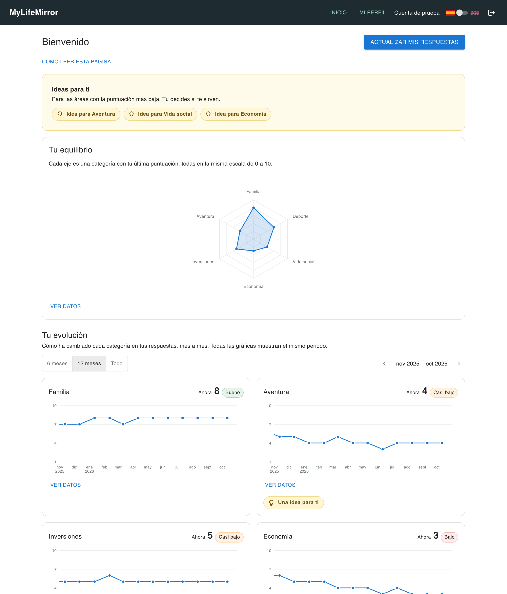
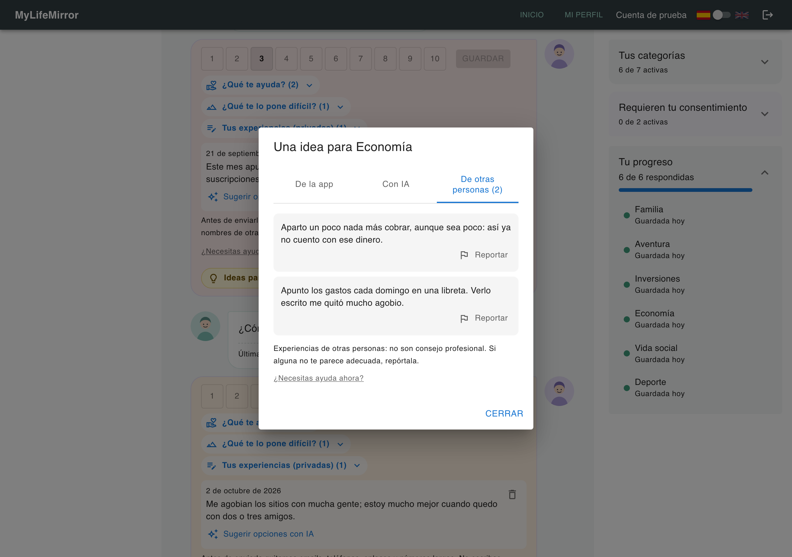
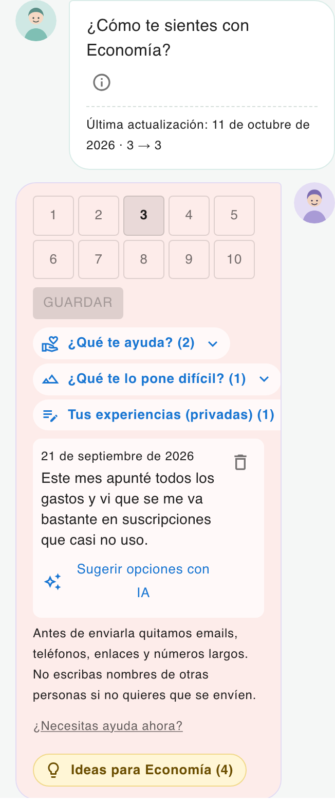

# MyLifeMirror

Aplicación web para evaluar cómo va tu vida por áreas (economía, familia, deporte…), ver tu equilibrio y su evolución, y recibir ideas concretas para mejorar lo que tú elijas, **sin juicios ni comparaciones**. Trabajo de Fin de Máster del Máster en Desarrollo con IA (BIG School).

- **En producción:** https://my-life-mirror.vercel.app
- **Arquitectura:** monolito modular con Clean Architecture en cada módulo (dominio / aplicación / infraestructura), TDD y especificación antes del código. Ver [docs/](docs/).

## Entrega del TFM

| Recurso | Dónde |
|---|---|
| Aplicación desplegada | https://my-life-mirror.vercel.app |
| Usuario de prueba | `demo@example.com` / `DemoUser123!` (ver [Usuario de prueba](#usuario-de-prueba)) |
| Presentación (slides) | ⏳ Pendiente |
| Vídeo explicativo | ⏳ Pendiente |
| Código fuente | Este repositorio (público) |

**Contenido:** [Así se ve](#así-se-ve) · [Funcionalidades](#funcionalidades-principales) · [Stack](#stack-tecnológico) · [Probarla en tu ordenador](#probarla-en-tu-ordenador-sin-cuentas) · [Usuario de prueba](#usuario-de-prueba) · [Estructura](#estructura-del-proyecto) · [Tests](#tests) · [Despliegue](#despliegue) · [Desarrollo con IA](#desarrollo-con-ia) · [Estado](#estado-del-proyecto) · [Licencia](#licencia) · [Documentación](#documentación)

---

## Así se ve

| Inicio: equilibrio y evolución | Ideas, también de otras personas | Entrevista en el móvil |
|---|---|---|
| [](docs/images/inicio.png) | [](docs/images/ideas-otras-personas.png) | [](docs/images/entrevista-movil.png) |

Capturas de la cuenta de prueba (ver [Usuario de prueba](#usuario-de-prueba)).

## Funcionalidades principales

- **Entrevista por áreas.** Eliges qué áreas de tu vida quieres mirar (economía, vida social, pareja, deporte, aventura, familia, inversiones…) y puntúas cada una del 1 al 10, cuando quieras y solo las que quieras. La primera vez va guiada en tres pasos.
- **Tu equilibrio y tu evolución.** Un radar con todas tus áreas y gráficos de cómo cambia cada una con el tiempo. Los colores son suaves y van siempre con número y texto: el color nunca es la única señal.
- **Ideas concretas, sin juicios.** Para las áreas con puntuación baja, la app propone ideas de un catálogo curado (5 por área), con el aviso de que no sustituyen el consejo profesional.
- **Ideas a tu medida.** Marcas qué te ayuda y qué te lo pone difícil (listas cerradas), y las ideas que chocan con tu situación dejan de proponerse.
- **Diario de experiencias.** Apuntas, por área, lo que te ha pasado o te ha funcionado. Es privado.
- **Compartir lo que funciona.** Si un área te va bien (8 o más), puedes compartir una experiencia de forma anónima. Quien busca ideas en esa área la lee junto a las de la app. Pasa unos filtros antes de publicarse y cualquiera puede reportarla.
- **IA opcional y acotada.** Desactivada por defecto. Puede reescribir una idea del catálogo para ti, o proponerte opciones de las listas a partir de una experiencia que tú elijas. Nunca valora cómo estás ni escribe consejos libres. *El modelo real está implementado y evaluado; falta activarlo en producción (ver [Estado](#estado-del-proyecto)).*
- **Ayuda siempre a mano.** "¿Necesitas ayuda ahora?" en todas las pantallas, con líneas de ayuda reales. Igual para todo el mundo: la app no intenta detectar nada.
- **Privacidad.** Consentimiento explícito para las áreas sensibles, exportación de todos tus datos en JSON y borrado completo de la cuenta.
- **Administración.** Catálogo de áreas en varios idiomas, gestión de usuarios y registro de auditoría.
- **Español e inglés**, y diseñada primero para móvil.

## Stack tecnológico

| Capa | Tecnología |
|---|---|
| Interfaz | React 19, TypeScript, Vite, Material UI, TanStack Query (caché de datos), react-i18next, Apache ECharts |
| Servidor | Funciones serverless de Vercel (`api/`), Node, Zod para validar la entrada |
| Datos y cuentas | Supabase: Postgres con migraciones SQL y autenticación gestionada |
| IA | API de Anthropic (Claude Haiku 5.5) con salida estructurada, detrás de un puerto; un proveedor simulado para desarrollo y tests |
| Calidad | Vitest y React Testing Library, Playwright (E2E), ESLint, Husky, GitHub Actions |

Las decisiones y sus motivos están en los [ADR](docs/architecture-decisions/).

---

## Probarla en tu ordenador (sin cuentas)

La forma más sencilla: la app completa contra una base de datos **local** en Docker. No necesitas cuenta de Vercel ni de Supabase, y no toca ningún dato real.

**Requisitos:** [Node.js 22](https://nodejs.org/) y [Docker Desktop](https://www.docker.com/products/docker-desktop/) abierto.

```bash
npm install
npm run dev:local
```

La primera vez descarga las imágenes de Supabase (unos minutos). Después se abre la app en **http://localhost:5175**. El script muestra también:

| Dirección | Para qué |
|---|---|
| http://localhost:5175 | La app. Crea una cuenta y empieza por la entrevista. |
| http://127.0.0.1:54323 | Supabase Studio local: ver las tablas y los usuarios que vas creando. |
| http://127.0.0.1:54324 | Buzón local: aquí llegan los correos de "¿Olvidaste tu contraseña?". |

Los datos se conservan entre arranques. Una vez arrancado, el Supabase local **vuelve a arrancar solo al abrir Docker Desktop** (sus contenedores quedan marcados "reiniciar salvo que se paren"); para que deje de hacerlo y liberar memoria, `npx supabase stop`. Para empezar de cero: `npx supabase db reset`. Para apagar la base local y liberar memoria: `npx supabase stop`.

### Probar como administrador

El rol de administrador no se puede pedir desde la app, a propósito (RNF-13). En local, regístrate y ejecuta en Studio (*SQL Editor*), con tu email:

```sql
update auth.users
set raw_app_meta_data = raw_app_meta_data || '{"rol": "admin"}'
where email = 'tu-email@ejemplo.com';
```

Cierra sesión y vuelve a entrar: aparecerá **Administración** en la cabecera (usuarios, catálogo de categorías y auditoría).

### Ver los gráficos con meses de historial

Una cuenta nueva solo tiene las respuestas de hoy. Para ver la evolución (y el radar) como si llevaras un año usando la app: activa algunas categorías, contesta la entrevista una vez y ejecuta [scripts/sql/simulated-history.sql](scripts/sql/simulated-history.sql) en el *SQL Editor* de Studio, con tu email. Añade una entrevista simulada al mes durante los 12 meses anteriores, sin tocar tus respuestas reales; el final del archivo trae la consulta para borrarlas.

### Idioma

Español por defecto; el interruptor con las banderas, arriba a la derecha, cambia a inglés (también antes de tener cuenta).

---

## Usuario de prueba

Una cuenta en producción que ya tiene contenido, para ver la app sin tener que rellenarla:

| | |
|---|---|
| Dirección | https://my-life-mirror.vercel.app |
| Email | `demo@example.com` |
| Contraseña | `DemoUser123!` |

**Qué trae:** seis áreas con un año de historial (el radar y la evolución), tres ideas abiertas, opciones marcadas en "¿Qué te ayuda?" y "¿Qué te lo pone difícil?", experiencias en el diario, la IA activada y experiencias compartidas por otra persona en la ventana de ideas.

**Qué probar:**

- *Inicio*: el equilibrio, la evolución y "Ideas para ti".
- *Mi perfil → Entrevista*: abre "Ideas para Economía" y mira las pestañas "De la app", "Con IA" y "De otras personas".
- En Aventura, pulsa "Sugerir opciones con IA" en la experiencia del diario.
- En Familia (un 8), "Compartir de forma anónima" una experiencia.
- *Mi perfil → Privacidad y datos*: descargar los datos.

Puedes cambiar lo que quieras: la cuenta se restaura con `npm run demo:reset`. Lo único que no permite es eliminarla (es compartida); para probar el borrado, crea tu propia cuenta: el registro está abierto y no pide confirmar el email. La administración no se ofrece en producción porque gestiona usuarios reales; se puede probar en local, como se explica arriba.

---

## Estructura del proyecto

```
api/                    Funciones serverless de Vercel: una por capacidad (cuentas, categorías, evaluaciones…)
src/
  modules/              Un módulo por capacidad de negocio
    accounts/             Registro, sesión, perfil, exportar y borrar datos
    categories/           Áreas de la vida, catálogo y opciones de "qué te ayuda"
    consent/              Consentimiento de las áreas sensibles
    assessments/          Entrevista, puntuaciones, historial y diario de experiencias
    recommendations/      Ideas, situaciones difíciles e IA
    wellbeing/            Líneas de ayuda
    panel/                Inicio (solo interfaz)
    admin/                Administración (solo interfaz)
  shared/               Lo común: Result, errores, contenedor, plantilla HTTP, tema, gráficos, traducciones
  pages/                Portada y política de privacidad
tests/                  Tests unitarios y de componentes, con la misma estructura que src/
e2e/                    Tests de extremo a extremo (Playwright); e2e/api/ contra un Supabase local
supabase/migrations/    Esquema de la base de datos, en orden
scripts/                Arranque local, comprobaciones de api/ y de producción
docs/                   Requisitos, decisiones de arquitectura, historias de usuario, validación
```

Dentro de cada módulo, las capas de Clean Architecture y la interfaz:

| Carpeta | Qué hay | Regla |
|---|---|---|
| `domain/` | Entidades, reglas y puertos (interfaces). El contenido curado va en `domain/catalog/`, como JSON. | No depende de nada externo. |
| `application/` | Casos de uso: uno por acción del usuario. | Solo conoce el dominio. |
| `infrastructure/` | Adaptadores: Supabase, proveedor de IA, y sus dobles en memoria para los tests. | Implementa los puertos. |
| `ui/` | Componentes de React. | Habla con el servidor por HTTP; nunca importa la infraestructura. |

El detalle está en [ADR-03](docs/architecture-decisions/03_Arquitectura_Software.md).

---

## Tests

| Comando | Qué comprueba |
|---|---|
| `npm run test` | Tests unitarios y de componentes (Vitest). |
| `npm run test:coverage` | Lo mismo con cobertura; falla si la lógica de negocio baja del umbral. |
| `npm run test:e2e` | Playwright sobre las páginas públicas (sin base de datos). |
| `npm run test:e2e:api` | Playwright de extremo a extremo con `api/` contra el Supabase local (Docker): registro, entrevista, consentimiento, panel, exportar y eliminar la cuenta, en móvil y escritorio. Vacía la base local en cada ejecución. |
| `npm run verify` | El *quality gate* completo que se ejecuta antes de cada `git push` (Husky): lint, tests con cobertura, build, comprobación de `api/` y e2e. |

Para **ver** los tests E2E funcionando:

```bash
npm run test:e2e:api -- --ui       # ventana interactiva: elegir un test, verlo y recorrer cada paso
npm run test:e2e:api -- --headed   # los navegadores se abren y la app se usa sola
npm run test:e2e:api -- --reporter=html && npx playwright show-report   # informe en el navegador
```

En GitHub, cada PR a `main` ejecuta `test:e2e:api` automáticamente (workflow **E2E con api**), y tras cada despliegue de producción se ejecuta una comprobación (`npm run smoke:prod`). El workflow **Seguridad** audita las dependencias y analiza el código (CodeQL) en cada PR. Más detalle en el [plan de verificación](docs/requirements-analysis/04_Plan_Verificacion_Validacion.md) (apartado 1.2).

---

## Desarrollo con el proyecto real (Vercel + Supabase)

Solo para quien tenga acceso a los proyectos de Vercel y Supabase del autor.

1. Copia `.env.example` a `.env` y rellena los valores (nunca se sube al repositorio).
2. `npx vercel link` una vez, con tu cuenta de Vercel.
3. `npm run dev:full` — frontend y `api/` juntos (`vercel dev`) contra la base **real**.

`npm run dev` arranca solo el frontend (sin `api/`). Las migraciones de `supabase/migrations/` se aplican a mano en el SQL Editor del proyecto real, en orden.

---

## Despliegue

- **Dónde:** [Vercel](https://vercel.com) sirve la interfaz y las funciones de `api/` (región de Dublín); [Supabase](https://supabase.com) aloja la base de datos y las cuentas. Los dos en su plan gratuito.
- **Cómo:** cada fusión en `main` despliega producción. Cada entrega es una versión con su etiqueta (`v1.3.0`…) y su sección en el [CHANGELOG](CHANGELOG.md).
- **Variables de entorno** (en Vercel; los nombres están en [.env.example](.env.example)): la URL y la clave de servicio de Supabase, la URL de la app y, para la IA, el proveedor y la clave de Anthropic. Las claves solo se usan en el servidor, nunca llegan al navegador.
- **Base de datos:** las migraciones de `supabase/migrations/` se ejecutan a mano, en orden, antes de desplegar el código que las necesita. El plan gratuito no guarda copias: `npm run backup:db` hace una en local.
- **Límites del plan gratuito:** 12 funciones como máximo (de ahí una función por capacidad, hoy 11) y pausa de Supabase tras 7 días sin uso (un workflow la evita).

---

## Seguridad

Revisada contra OWASP Top 10:2025, el OWASP Top 10 para aplicaciones con LLM y MITRE ATT&CK; el análisis, los hallazgos y lo aplicado están en el [plan de seguridad](docs/security/01_Plan_Seguridad.md). En resumen:

- **Cuentas:** las contraseñas las guarda Supabase Auth, nunca la app. Las nuevas deben ser fuertes (12 caracteres o más, variadas, sin secuencias ni palabras comunes, sin el nombre ni el email) y el formulario explica qué falta. El inicio de sesión no da pistas y los intentos están contados por IP y por cuenta.
- **Sesión:** cookie `HttpOnly`, `Secure` y `SameSite=Lax` de una hora; el usuario sale siempre de la sesión verificada en el servidor.
- **Datos:** todas las tablas con seguridad por filas y sin políticas: solo el servidor accede. Entradas validadas con esquemas, con longitudes máximas.
- **Navegador:** política de contenido (CSP) y demás cabeceras de seguridad; las acciones que cambian datos rechazan peticiones de otras webs.
- **IA:** opcional, con salida cerrada y validada, tope de uso, y sin obedecer órdenes escritas en el texto del usuario.
- **Código y dependencias:** secretos fuera del repositorio; `npm audit`, CodeQL y Dependabot en GitHub. Se probó además Snyk, que encontró un fallo sin corregir en una dependencia, ya mitigado.

---

## Desarrollo con IA

El proyecto se ha construido con un asistente de IA (Claude Code) como compañero de programación, con reglas escritas para que el resultado sea revisable:

- **Convenciones en un solo sitio:** [AGENTS.md](AGENTS.md) recoge la arquitectura, las prohibiciones y los comandos que el asistente debe respetar.
- **Especificación antes que código:** cada funcionalidad empieza por una historia de usuario con criterios Given/When/Then ([docs/user-stories/](docs/user-stories/)), y cada pieza por su test (TDD).
- **Decisiones trazables:** [docs/Historial_Prompts.md](docs/Historial_Prompts.md) registra los prompts que fijaron una decisión de diseño, proceso o alcance, y qué se decidió.
- **Controles automáticos:** nada se da por bueno sin lint, tipos, tests con umbral de cobertura, build y E2E (`npm run verify`), ni sin revisión de código.
- **Límites éticos de la IA dentro de la app:** [ADR-05](docs/architecture-decisions/05_Fundamentos_IA.md) explica dónde se usa IA, dónde no y por qué (sin detección de riesgo, sin consejo generado libremente).

---

## Estado del proyecto

Funcionalidad del MVP y del Ciclo 2 terminada y en producción (v1.3.0), con más de 800 tests. Entrega prevista del TFM: hacia el 20 de octubre de 2026 (como máximo, el 26).

- **IA:** el modelo real (RF-40b) funciona en producción desde esta versión, con crédito de prepago y un tope diario por usuario ([evaluación](docs/architecture-decisions/05_Fundamentos_IA.md), apartado 4.3.4). En local y en los tests se usa un proveedor simulado, para no gastar crédito.
- **Para la entrega:** presentación y vídeo.
- **Límites conocidos:** validación con una sola participante; política de privacidad sin revisión legal; contenido de ideas y líneas de ayuda pendiente de una última revisión.

El detalle, con las decisiones y la deuda técnica abiertas, está en el [tablero](docs/project-management/01_Backlog_MVP.md).

## Licencia

Todos los derechos reservados. El repositorio es público para que el código y la documentación puedan leerse, descargarse y evaluarse; no se permite copiarlos, modificarlos, distribuirlos ni reutilizarlos sin permiso del autor. Ver [LICENSE](LICENSE).

## Documentación

- [docs/README.md](docs/README.md) — **mapa de toda la documentación** y por dónde empezar.
- [AGENTS.md](AGENTS.md) — convenciones del proyecto y comandos (punto de entrada).
- [Requisitos](docs/requirements-analysis/) · [Decisiones de arquitectura (ADR)](docs/architecture-decisions/) · [Historias de usuario](docs/user-stories/) · [Tablero](docs/project-management/01_Backlog_MVP.md) · [Validación](docs/validation/)
- [CHANGELOG.md](CHANGELOG.md) — cambios por versión.
