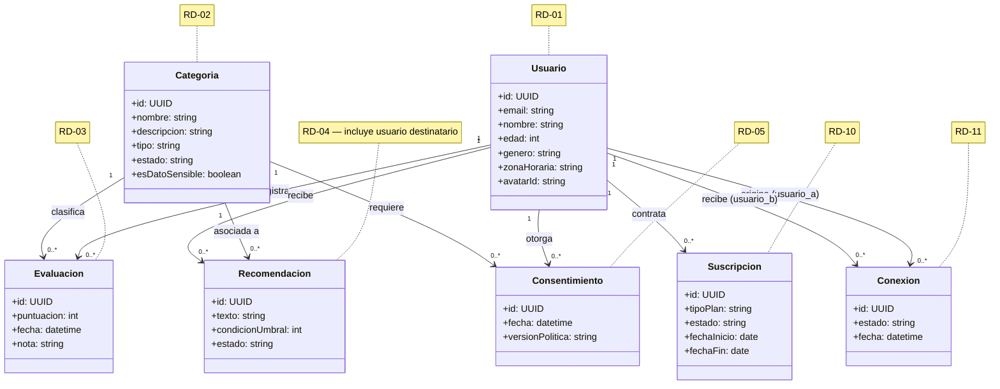

# Diagrama de Clases (Modelo de Dominio) — Fase 2

**Basado en:** [02_Requisitos_Fase1.md](02_Requisitos_Fase1.md) v0.3, sección 5 (RD-01 a RD-11)
**Fecha:** 7 de septiembre de 2026
**Formato:** Mermaid (texto plano, versionable en git, editable directamente en este archivo — pensado para crecer en próximas fases sin rehacer nada desde cero).

---

## 1. Diagrama

---

## 2. Hallazgos detectados al construir el diagrama — ✅ resueltos

Igual que con la matriz de trazabilidad, dibujar el modelo sacó a la luz dos cosas que en texto no se veían, ya resueltas en `02_Requisitos_Fase1.md` v0.4:

- **`Recomendación` ahora incluye el usuario destinatario** — cada recomendación queda registrada como propuesta a un usuario concreto, no solo a una categoría.
- **Estados alineados con RF-19**: `pendiente de respuesta / hecha / descartada / pospuesta`. "Pendiente" es explícitamente el estado inicial, antes de que el usuario responda; "pospuesta" es una respuesta del usuario para retomarla más adelante.

---

## 3. Por qué este formato es "dinámico" de cara a las próximas fases

- Añadir una entidad nueva (por ejemplo, si en el Ciclo 3 se decide separar "plantilla de recomendación" de "recomendación asignada") es añadir un bloque `class` más y una línea de relación — no rehacer el diagrama.
- Vive en el propio repositorio como texto: se versiona con git igual que el código, y GitHub lo renderiza automáticamente al ver el archivo.
- Puedo regenerarlo contigo en segundos cada vez que cambie el modelo de datos, igual que cualquier otro documento de esta carpeta.

---

## 4. Próximo paso

Con el modelo de dominio cerrado, seguimos con el **diagrama de secuencia del check-in** ([06_Diagrama_Secuencia_CheckIn.md](06_Diagrama_Secuencia_CheckIn.md)).

---

## Historial de cambios

- **v1.0 (7 sept. 2026)** — versión inicial del diagrama de clases a partir de RD-01 a RD-11. Se detectan dos hallazgos (campo `usuario` faltante en RD-04, inconsistencia de estados entre RD-04 y RF-19).
- **v1.1 (7 sept. 2026)** — hallazgos resueltos: `Recomendación` incluye usuario destinatario; estados alineados a `pendiente de respuesta/hecha/descartada/pospuesta`, reflejado también en `02_Requisitos_Fase1.md` v0.4.
