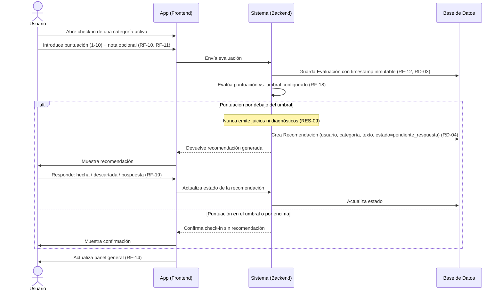

# Diagrama de Secuencia — Flujo de Check-in

> **Análisis inicial (5-12 sept. 2026), no el diseño actual.** Es el modelo conceptual previo al código y se conserva como parte del proceso del TFM. Usa los nombres del análisis; en el código son: `Usuario` → `User` (módulo `accounts`), `Evaluacion` → `Assessment`, "check-in" → la entrevista (RF-10), `Recomendacion` → `Recommendation`, `Consentimiento` → `Consent`, `Categoria` → `Category`. `Conexion` y `Suscripcion` no están construidas (Ciclo 3 o posterior). El diseño real: [ADR-03](../architecture-decisions/03_Arquitectura_Software.md), las [historias de usuario](../user-stories/) y `src/modules/`.

**Basado en:** [02_Requisitos_Fase1.md](02_Requisitos_Fase1.md), [05_Diagrama_Clases.md](05_Diagrama_Clases.md)
**Fecha:** 7 de septiembre de 2026
**Formato:** Mermaid (renderiza automáticamente en GitHub al ver el archivo .md — sin plugin ni configuración adicional).

Este es el flujo más central del sistema: cubre puntuación (RF-10, RF-11), inmutabilidad del registro (RF-12), motor de recomendaciones por umbral (RF-18), respuesta del usuario a la recomendación (RF-19) y el límite ético de no emitir juicios (RES-09).

> **Nota:** el consentimiento para categorías sensibles (RF-04) **no** ocurre aquí — se resuelve al activar la categoría (onboarding o gestión posterior de categorías, RF-07), ver [08_Diagrama_Secuencia_Consentimiento.md](08_Diagrama_Secuencia_Consentimiento.md). Este flujo asume que solo se puede hacer check-in de categorías ya activas y, si eran sensibles, ya consentidas.

---

## 1. Diagrama

---

## 2. Notas de lectura

- Los dos bloques `alt` son ramas alternativas reales del flujo, no pasos opcionales de UI — el primero depende de si ya existe consentimiento previo para esa categoría; el segundo, de si la puntuación dispara o no una recomendación.
- El `Note over Sistema` en el punto de generación de la recomendación está ahí deliberadamente: es el punto exacto del flujo donde RES-09 aplica (el sistema decide *si* mostrar una recomendación por umbral, nunca *interpreta* por qué el usuario puntuó bajo).
- `Sistema` aquí es una capa lógica (API + reglas de negocio), no implica todavía una decisión de arquitectura concreta (Firebase Functions, Supabase, etc. — eso es una decisión de RES-03/RES-06 para más adelante).

## 3. Cómo probarlo en GitHub
Al hacer commit y push de este archivo, GitHub renderiza el bloque \`\`\`mermaid automáticamente en la vista del archivo — no hace falta ninguna extensión ni configuración.
