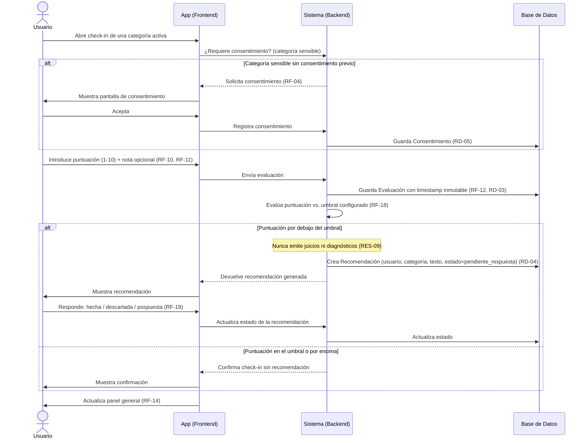

# Diagrama de Secuencia — Flujo de Check-in

**Basado en:** [02_Requisitos_Fase1.md](02_Requisitos_Fase1.md) v0.4, [05_Diagrama_Clases.md](05_Diagrama_Clases.md) v1.1
**Fecha:** 7 de septiembre de 2026
**Formato:** Mermaid (renderiza automáticamente en GitHub al ver el archivo .md — sin plugin ni configuración adicional).

Este es el flujo más central del sistema: cubre consentimiento (RF-04), puntuación (RF-10, RF-11), inmutabilidad del registro (RF-12), motor de recomendaciones por umbral (RF-18), respuesta del usuario a la recomendación (RF-19) y el límite ético de no emitir juicios (RES-09).

---

## 1. Diagrama

---

## 2. Notas de lectura

- Los dos bloques `alt` son ramas alternativas reales del flujo, no pasos opcionales de UI — el primero depende de si ya existe consentimiento previo para esa categoría; el segundo, de si la puntuación dispara o no una recomendación.
- El `Note over Sistema` en el punto de generación de la recomendación está ahí deliberadamente: es el punto exacto del flujo donde RES-09 aplica (el sistema decide *si* mostrar una recomendación por umbral, nunca *interpreta* por qué el usuario puntuó bajo).
- `Sistema` aquí es una capa lógica (API + reglas de negocio), no implica todavía una decisión de arquitectura concreta (Firebase Functions, Supabase, etc. — eso es una decisión de RES-03/RES-06 para más adelante).

## 3. Cómo probarlo en GitHub
Al hacer commit y push de este archivo, GitHub renderiza el bloque \`\`\`mermaid automáticamente en la vista del archivo — no hace falta ninguna extensión ni configuración.

---

## 4. Próximo paso

Siguiente diagrama: **casos de uso** (mejor candidato para draw.io, por la notación UML completa que necesita) o el **diagrama de estados de `Recomendación`** (pendiente_respuesta → hecha/descartada/pospuesta) — dime cuál prefieres.

---

## Historial de cambios

- **v1.0 (7 sept. 2026)** — versión inicial: secuencia completa del check-in, desde apertura hasta actualización del panel, incluyendo consentimiento condicional y respuesta a recomendación.
