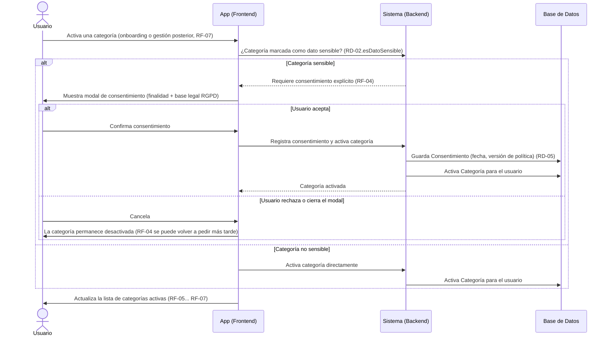

# Diagrama de Secuencia — Activación de Categoría y Consentimiento

**Basado en:** [02_Requisitos_Fase1.md](02_Requisitos_Fase1.md) v0.4 (RF-04, RF-07, RD-02, RD-05), [07_Diagrama_Casos_Uso.md](07_Diagrama_Casos_Uso.md) §3-4
**Fecha:** 7 de septiembre de 2026
**Formato:** Mermaid.

Este flujo se dispara cada vez que una categoría pasa de inactiva a activa — durante el onboarding (elección inicial de categorías al registrarse) o más tarde, al activar una categoría nueva desde la gestión de categorías (RF-07). Es el mismo modal en ambos casos.

---

## 1. Diagrama

---

## 2. Notas de lectura

- El disparador es siempre la **transición inactiva → activa** de una categoría marcada `esDatoSensible=true` (RD-02) — no importa si ocurre en el onboarding o meses después al activar una categoría nueva.
- Rechazar el consentimiento **no bloquea el resto de la app**: la categoría simplemente queda desactivada; el usuario puede volver a intentarlo cuando quiera desde la gestión de categorías.
- Este es el flujo que corresponde a la relación `<<extend>>` del diagrama de casos de uso ([07_Diagrama_Casos_Uso.drawio](07_Diagrama_Casos_Uso.drawio)): "Otorgar consentimiento" extiende a "Configurar categorías de vida" solo bajo esta condición.

---

## 3. Próximo paso

Con el flujo de consentimiento separado y correcto, el check-in ([06](06_Diagrama_Secuencia_CheckIn.md)) y la activación de categorías (este archivo) quedan consistentes entre sí y con el diagrama de casos de uso. Siguiente diagrama pendiente de la lista: **diagrama de estados de `Recomendación`** (pendiente de respuesta → hecha/descartada/pospuesta) — dime si quieres continuar con ese o prefieres pasar ya a las historias de usuario del Ciclo 1 (MVP).

---

## Historial de cambios

- **v1.0 (7 sept. 2026)** — versión inicial: flujo de activación de categoría con consentimiento condicional, extraído de `06_Diagrama_Secuencia_CheckIn.md` para resolver la inconsistencia detectada en el diagrama de casos de uso.
