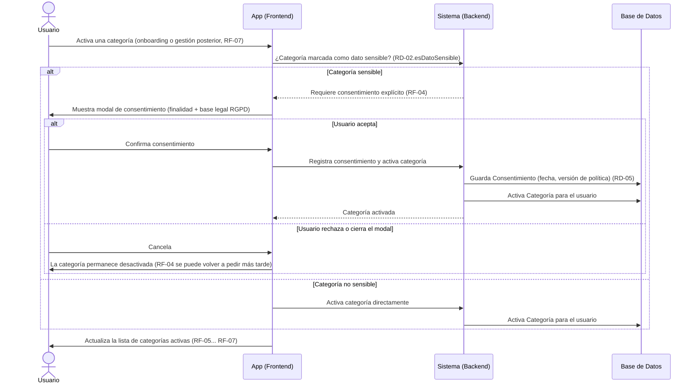

# Diagrama de Secuencia — Activación de Categoría y Consentimiento

> **Análisis inicial (5-12 sept. 2026), no el diseño actual.** Es el modelo conceptual previo al código y se conserva como parte del proceso del TFM. Usa los nombres del análisis; en el código son: `Usuario` → `User` (módulo `accounts`), `Evaluacion` → `Assessment`, "check-in" → la entrevista (RF-10), `Recomendacion` → `Recommendation`, `Consentimiento` → `Consent`, `Categoria` → `Category`. `Conexion` y `Suscripcion` no están construidas (Ciclo 3 o posterior). El diseño real: [ADR-03](../architecture-decisions/03_Arquitectura_Software.md), las [historias de usuario](../user-stories/) y `src/modules/`.

**Basado en:** [02_Requisitos_Fase1.md](02_Requisitos_Fase1.md) (RF-04, RF-07, RD-02, RD-05), [07_Diagrama_Casos_Uso.md](07_Diagrama_Casos_Uso.md) apartado 3-4
**Fecha:** 7 de septiembre de 2026
**Formato:** Mermaid.

Este flujo se dispara cada vez que una categoría pasa de inactiva a activa — durante el onboarding (elección inicial de categorías al registrarse) o más tarde, al activar una categoría nueva desde la gestión de categorías (RF-07). Es el mismo modal en ambos casos.

---

## 1. Diagrama

---

## 2. Notas de lectura

- El disparador es siempre la **transición inactiva → activa** de una categoría marcada `esDatoSensible=true` (RD-02) — no importa si ocurre en el onboarding o meses después al activar una categoría nueva.
- Rechazar el consentimiento **no bloquea el resto de la app**: la categoría simplemente queda desactivada; el usuario puede volver a intentarlo cuando quiera desde la gestión de categorías.
- Este es el flujo que corresponde a la relación `<<extend>>` del diagrama de casos de uso ([07_Diagrama_Casos_Uso.drawio](07_Diagrama_Casos_Uso.drawio)): "Otorgar consentimiento" extiende a "Configurar categorías de vida" solo bajo esta condición.
