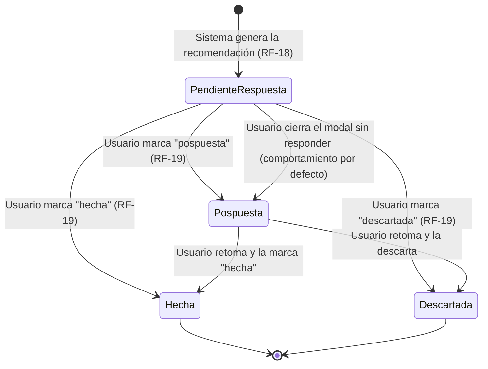

# Diagrama de Estados — `Recomendación`

**Basado en:** [02_Requisitos_Fase1.md](02_Requisitos_Fase1.md) v0.4 (RD-04, RF-18, RF-19, RF-20, RF-21)
**Fecha:** 7 de septiembre de 2026
**Formato:** Mermaid (`stateDiagram-v2`).

---

## 1. Diagrama

---

## 2. Decisiones de diseño (a confirmar)

- **`Pospuesta` no vuelve a `PendienteRespuesta`**: desde pospuesta, el usuario resuelve directamente a `Hecha` o `Descartada` cuando la retoma, en vez de reiniciar el ciclo. Evita que una recomendación quede rebotando indefinidamente entre "pendiente" y "pospuesta".
- **Cerrar el modal sin responder = pospuesta, por defecto**: si el usuario no quiere decidir en ese momento y simplemente cierra/cancela el modal, el sistema no la deja indefinidamente en `PendienteRespuesta` — pasa a `Pospuesta` automáticamente, igual que si la hubiera pospuesto explícitamente. Ningún estado queda "abierto" sin que el usuario haya al menos tenido la oportunidad de decidir.
- **`Hecha` y `Descartada` son estados finales** para esa instancia de recomendación — no se reabren. Si el usuario quiere revisar algo ya descartado, eso es una recomendación nueva (ver siguiente punto), no reabrir la antigua.
- **RF-21 (pedir alternativa)** no es una transición de estado de la misma recomendación: la actual pasa a `Descartada` y el sistema genera una **nueva** instancia en `PendienteRespuesta`. Mantiene el historial limpio (RD-07) sin inventar un quinto estado.
- **RF-20 (adaptación futura)** no participa en este diagrama de estados — usa el *historial* de instancias ya resueltas (`Hecha`/`Descartada`) como señal para decidir qué recomendar después, es lógica de generación, no un estado adicional de la entidad.

## 3. Idea previa, ahora parcialmente resuelta por RF-34
La preocupación de que una `Pospuesta` nunca retomada "se pierda" queda cubierta por **RF-34** (§4): el usuario puede consultar y filtrar por estado en cualquier momento, así que las pospuestas no desaparecen. Queda abierta una versión más proactiva —que el resumen mensual (RF-31) las saque a relucir solas, sin que el usuario tenga que ir a buscarlas— como posible extensión futura si quieres reforzarlo. No lo añado sin que lo confirmes.

---

## 4. Nuevo requisito derivado de este diagrama — historial de recomendaciones
Al razonar sobre qué pasa con las recomendaciones a lo largo del tiempo, surge un requisito que no estaba en el documento: el usuario necesita poder **consultar el historial completo de sus recomendaciones**, no solo las pendientes activas. Añadido como:

> **RF-34** | El sistema debe permitir al usuario consultar el historial completo de sus recomendaciones (en cualquier estado: pendiente de respuesta, hecha, descartada, pospuesta), con filtros por estado, categoría y rango de fechas. | Should

Ya reflejado en `02_Requisitos_Fase1.md` v0.5 y en la matriz de trazabilidad (asociado a RN-02, ya que es una extensión natural de "el sistema genera recomendaciones" hacia "y permite revisarlas").

## 5. Próximo paso

Con esto se completa el set de diagramas de la Fase 2 (clases, dos secuencias, casos de uso, estados). Buen momento para pasar a las **historias de usuario con criterios de aceptación del Ciclo 1 (MVP)** — el punto 5 pendiente en `02_Requisitos_Fase1.md`. ¿Seguimos por ahí?

---

## Historial de cambios

- **v1.0 (7 sept. 2026)** — versión inicial: estados `pendiente_respuesta/hecha/descartada/pospuesta`, transiciones desde pospuesta a estados finales, notas sobre RF-20/RF-21 y una idea a validar (pospuestas en el resumen mensual).
- **v1.1 (7 sept. 2026)** — se añade transición "cerrar modal sin responder → Pospuesta" (comportamiento por defecto). Se deriva y documenta RF-34 (historial de recomendaciones con filtros), que cubre gran parte de la idea pendiente del punto 3.
